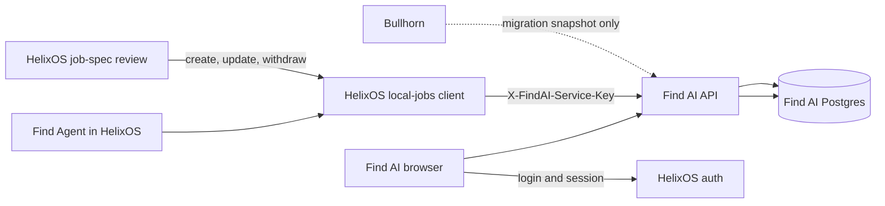

# Find AI local Postgres jobs

**Date:** 2026-11-16
**Status:** Implementation and local validation complete; production cutover is not approved or performed.

## Decision

Find AI owns the complete public jobs lifecycle in its Postgres database: reads, search, staff create/edit/publish/unpublish, spreadsheet or advert uploads, deletes, and applications. Find Agent continues to run in HelixOS, but its job tools call Find AI's private jobs API. There is no Bullhorn fallback or proxy in this path.

Login, candidate and client accounts, profiles, agent runtime, job-spec review, and agent notifications remain HelixOS responsibilities.



## Ownership and invariants

| Data or operation | System of record after cutover | Invariant |
|---|---|---|
| Published and draft jobs, advert bodies, metadata, slugs, status, dates | Find AI Postgres (`findai_jobs`) | Public handlers never query Bullhorn. Drafts and soft-deleted jobs are not public. |
| Applications and CV text | Find AI Postgres (`findai_job_applications`) | Application is written locally before notification; a deleted job retains application history. |
| Legacy advert and LR overlay metadata | Find AI Postgres (`findai_legacy_adverts`, `findai_legacy_lr_imports`) | These are audit and migration metadata, not a live Bullhorn dependency. |
| First-seen and added-date history | Find AI Postgres (`job_first_seen`) | Existing ordering and the 15 explicit added dates are preserved. |
| Login, session, account, profile, agent runtime | HelixOS | The Find AI site keeps its existing HelixOS auth/session calls. |
| Job-spec review and self-serve state | HelixOS | `LocalJobID` links an approved spec to the local job; `AdvertJobID` remains legacy-only. Withdraw clears the local link and soft-deletes the local job. |
| Generic Bullhorn integrations | HelixOS, until separately retired | Do not disable the shared Bullhorn manager or HTTPS proxy until other tenants and tools have been checked. |

## API boundary

The public wire shape stays unchanged:

- `GET /api/findai/jobs`
- `GET /api/findai/jobs/{slug}`
- `POST /api/findai/jobs/{slug}/apply` (JSON or CV multipart upload)

Staff operations are local:

- `GET|POST /api/findai/staff/jobs`
- `POST /api/findai/staff/jobs/preview`
- `GET|PUT|DELETE /api/findai/staff/jobs/{id}`

The HelixOS client uses the private Find AI endpoint configured by `FINDAI_LOCAL_JOBS_URL` (default: the Find AI site's `/api/internal/jobs` endpoint) and sends `X-FindAI-Service-Key: $FINDAI_PUBLIC_API_KEY` on every request. `FINDAI_LOCAL_JOBS_URL` belongs in HelixOS only. The Find AI API's `HELIXOS_FINDAI_KEY` must contain the same secret value as HelixOS `FINDAI_PUBLIC_API_KEY`. The key is a service secret, never a browser credential. Search, get, create, update, delete, and apply all use this client. A failed call is an error; it is not a reason to query Bullhorn.

HelixOS continues to expose the signed-in application-context, application-notification, and withdrawal-reconciliation callbacks. Those callbacks use the same service-key header. They preserve the authoritative HelixOS identity and existing staff alert behavior without creating a second application record.

The public board preserves the current 64 published roles, including the 56 open roles and 8 closed evergreen roles. Closed details remain readable, but a closed role cannot accept an application. Confidential companies are blanked in public DTOs and are not searchable through the company field. Only published, non-deleted rows are searchable; applications require an open role.

## Migration evidence and source handling

The protected migration manifest is:

`/Users/psamuel/.codex/artifacts/findai-jobs/2026-11-16/findai-jobs-migration-20261116.json`

It is mode `0600` and contains candidate application PII and CV text. Keep it on the protected operator host. Do not copy it into Git, a design document, logs, tickets, or chat. Snapshot time was `2026-11-16T10:51:35Z`.

The manifest inventory is:

| Item | Count | Notes |
|---|---:|---|
| Full job DTOs | 64 | 56 open, 8 closed evergreen; all advert bodies included |
| Applications | 27 | 1 is orphaned and remains linked by its original slug/metadata |
| Legacy advert overlays | 68 | Preserved for audit |
| LR imports | 53 | 5 do not match a migrated job and remain explicitly unlinked |
| First-seen rows | 64 | Existing history preserved |
| Explicit added dates | 15 | Existing ordering preserved |

All 64 full DTOs were semantically compared with the source snapshot, including advert content and timestamps as instants. The migration retains the legacy Bullhorn IDs for audit only; they are not live foreign keys.

The snapshot is a bounded source export, not a continuing sync. Anything created or changed after it must be captured by a final delta export or a write freeze before traffic changes. Applications must be included in that delta so no post-export application is lost.

## Executable cutover

1. Announce a short maintenance boundary. Stop staff job writes, or record an exact final-delta window. Keep the current site serving reads while the local schema is seeded.
2. Ensure the Find AI API points at the persistent Postgres volume. Put the shared service secret in Find AI as `HELIXOS_FINDAI_KEY` and in HelixOS as `FINDAI_PUBLIC_API_KEY`; these values must match. Set `FINDAI_LOCAL_JOBS_URL` in HelixOS only. Do not put a production DSN or key in this document or shell history.
3. Run the import dry run from the Find AI API checkout. This parses and validates only:

   ```sh
   cd /path/to/find-ai/api
   go run ./cmd/import-jobs -input /Users/psamuel/.codex/artifacts/findai-jobs/2026-11-16/findai-jobs-migration-20261116.json
   ```

   Expected report: 64 jobs, 27 applications, 1 orphan application, 68 legacy adverts, 53 LR imports, 5 unlinked LR imports, and 64 first-seen rows.

4. Review the report, then apply once with the secret-managed Postgres DSN. `-apply` is the mutation boundary and runs in one transaction:

   ```sh
   cd /path/to/find-ai/api
   DATABASE_URL='<secret-managed-findai-postgres-dsn>' \
     go run ./cmd/import-jobs \
       -input /Users/psamuel/.codex/artifacts/findai-jobs/2026-11-16/findai-jobs-migration-20261116.json \
       -apply
   ```

   Re-running the same manifest is idempotent and must not resurrect a soft-deleted job.

5. Under a bounded write freeze, export the final delta, including created, edited, unpublished, and deleted jobs plus every new application. The importer uses insert-on-conflict `DoNothing` for existing jobs and applications, so do not imply that rerunning the manifest updates seeded rows. Reconcile changed jobs by slug through the reviewed local update/delete path, and applications by immutable ID. Do not proceed if any application is present in the old store but absent locally.
6. In one bounded maintenance window, deploy the paired Find AI API/frontend and HelixOS versions. The HelixOS deployment must include the local-jobs client and application/withdrawal callbacks and remove the old Find AI Bullhorn job routes. Keep callback-dependent writes paused until both deployments are healthy, then configure `HELIXOS_FINDAI_KEY` in Find AI to match `FINDAI_PUBLIC_API_KEY` in HelixOS, set `FINDAI_LOCAL_JOBS_URL` in HelixOS, and restart/release both sides together.
7. Verify before declaring success:

   - list count, every slug, title, public metadata, advert body, and content hash;
   - open/closed status, confidential-company redaction, added-date ordering, and sitemap/detail links;
   - staff create, edit, spreadsheet/advert preview and import, publish, unpublish, and delete;
   - candidate JSON and multipart applications, duplicate protection, closed-role rejection, persistence, and notification;
   - Find Agent search, get, result-card links, and apply through HelixOS, with a deliberate unavailable-local-service check proving there is no Bullhorn fallback;
   - self-serve approve, retry/idempotency, and withdraw/reconciliation using `LocalJobID`.

8. Retain the protected manifest and a Postgres backup. Only after the checks pass should Find AI-specific Bullhorn job routes, the two Find AI Bullhorn credential records, or old sync tasks be removed under a separate approval. Do not remove the shared tunnel, Squid listener, firewall rule, or `BULLHORN_HTTPS_PROXY` at this cutover.

## Post-cutover Find AI-only cleanup

This is a separate, approved change after the cutover checks and backups. The live inventory confirmed that the Bullhorn egress path is shared and must remain: the database has 9 active Bullhorn credential records, 2 for `org_findai` and 7 for other orgs across 6 orgs. No global egress cleanup is authorized at the Find AI cutover.

The confirmed shared targets are `bullhorn-egress-tunnel.service` binding `172.18.0.1:3128`, `/etc/bullhorn-egress` keys, the `/root/helixos/docker-compose.prod.yml` override, node01 container `bullhorn-egress-proxy-1` listening on `127.0.0.1:3128`, `/prod/home/luke/pm/infra/node01/bullhorn-egress/{compose.yaml,squid.conf}`, and the matching `DOCKER-USER` rule. Do not retire or alter these shared targets, and do not remove global `BULLHORN_HTTPS_PROXY`, until every other consumer is retired or has an approved replacement.

1. After the cutover checks and backup, obtain separate approval to retire only the 2 active `org_findai` Bullhorn credential records. Confirm that Find AI job reads, writes, applications, agents, and self-serve flows no longer reference them.
2. Remove the Find AI-specific job routes and old sync tasks, then remove only those 2 Find AI credential records. Leave the 7 records for the other 6 orgs and all shared egress infrastructure unchanged.
3. Record the credential inventory and before/after references. Keep the Postgres backup, local job data, and application history as the rollback source; do not restore the old Find AI Bullhorn path as a way to recover new local writes.

## Rollback and recovery

Before local writes begin, traffic can return to the previous application and the protected source snapshot can be replayed. After local creates, edits, deletes, or applications begin, do not blindly roll back to Bullhorn: new local jobs and candidate applications do not exist there. Keep the local database and its backup authoritative, restore the local service or repair forward, and reconcile any queued delta by immutable application ID and job slug. If the shared network tunnel or proxy was disabled, restore it only for the unrelated integrations that still require it.

## Verification status

The Find AI API and HelixOS focused test suites, TypeScript checks, frontend tests/build, import dry run, semantic parity comparison, and repeated idempotent import were run in the implementation worktrees. No production migration, production write, traffic flip, or Bullhorn disconnection has been performed or verified.
